# Examen Segundo Parcial — Pipeline de datos contenerizado (DataMart)

**Materia:** Manejo Masivo de Datos (Big Data)
**Matrícula:** `125053685`  (último dígito **5**)
**Pregunta de negocio asignada (dígitos 4 o 5):** *Unidades vendidas por **método de pago** y **día de la semana**.*

> Estado: completo y probado desde cero (`docker compose down -v && docker compose up --build`). Las evidencias (logs de terminal) están en [`evidencias/`](evidencias/).

## 1. Arquitectura

```
 ./data/ventas_125053685.csv ──(ro)──► [hadoop]  Hadoop 3.3.6 standalone + Python + sshd
                                          │  hadoop streaming (mapper.py / reducer.py)
                                          ▼
                                  volumen mr_output  (part-00000)
                                          │  scripts/cargar_resultados.py
                                          ▼
                       [db] PostgreSQL 16 (volumen pgdata) ◄── [api] Flask :5000 (CRUD)
        Red: datamart_net        ssh_keys (volumen): llave compartida  api ──ssh──► hadoop
```

## 2. Estructura del repositorio

```
├── README.md  .gitignore  .env.example  docker-compose.yml
├── hadoop/      Dockerfile, entrypoint.sh, cache/ (tarball opcional, ignorado por git)
├── mapreduce/   mapper.py  reducer.py  secuencial.py  run_job.sh
├── api/         Dockerfile  requirements.txt  app.py  entrypoint.sh
├── scripts/     generar_dataset.py  cargar_resultados.py
├── data/        (aquí va el CSV; NO se sube)
└── evidencias/  logs y capturas
```

## 3. Pasos para reproducir (Ubuntu / Linux)

```bash
# 0. Dataset (semilla = matrícula). Queda fuera de git (*.csv en .gitignore)
cd data && python3 ../scripts/generar_dataset.py 125053685 && cd ..

# 1. Variables de entorno (la contraseña real NO se versiona)
cp .env.example .env        # edita POSTGRES_PASSWORD

# 2. Levantar TODO con un comando
docker compose up --build -d

# 3. Verificaciones
docker compose exec -u hadoop hadoop hadoop version
docker compose exec -u hadoop hadoop ssh localhost hostname
docker compose exec api ssh hadoop hostname            # api -> hadoop por nombre de servicio

# 4. Job MapReduce (Hadoop Streaming)
docker compose exec -u hadoop hadoop bash -c 'time /opt/mapreduce/run_job.sh'
docker compose exec -u hadoop hadoop cat /data/output/resultado/part-00000

# 5. Comparativa secuencial + verificación de igualdad
docker compose exec -u hadoop hadoop bash -c 'time python3 /opt/mapreduce/secuencial.py /data/input/ventas_125053685.csv /tmp/seq.txt'
docker compose exec -u hadoop hadoop diff /tmp/seq.txt /data/output/resultado/part-00000 && echo IGUALES

# 6. Cargar a PostgreSQL y consultar la API
docker compose exec api python scripts/cargar_resultados.py
curl localhost:5000/resultados
curl localhost:5000/resultados/Efectivo
curl "localhost:5000/resultados/Tarjeta?dia=3"

# 7. CRUD de escritura
curl -X POST localhost:5000/resultados -H 'Content-Type: application/json' \
     -d '{"metodo_pago":"Cripto","dia_num":1,"unidades_vendidas":10}'
curl -X PUT  localhost:5000/resultados/29 -H 'Content-Type: application/json' -d '{"unidades_vendidas":99}'
curl -X DELETE localhost:5000/resultados/29

# 8. Persistencia
docker compose down && docker compose up -d && curl localhost:5000/resultados   # los datos siguen
docker compose down -v                                                         # borra volúmenes (datos perdidos)
```

Cambiar el puerto de la API: editar `API_PORT` en `.env` y ejecutar `docker compose up -d`.

**Nota sobre la descarga de Hadoop:** el Dockerfile descarga el tarball oficial de `archive.apache.org` y verifica su SHA-512. Si existe `hadoop/cache/hadoop-3.3.6.tar.gz` lo usa (build rápido/offline) y aun así valida el checksum oficial.

## 4. Decisiones de diseño por parte

| Parte | Implementación |
|---|---|
| A1 | `debian:bookworm-slim`, OpenJDK 17, Python 3, Hadoop 3.3.6 standalone; `JAVA_HOME`, `HADOOP_HOME`, `PATH` en `ENV` y en `/etc/environment` (para sesiones SSH). |
| A2 | 3 servicios, red `datamart_net`, volumen nombrado `pgdata`, `.env`, `api` con `depends_on` a `db` (healthy) y `hadoop`; dataset en `/data/input:ro`. |
| B | `openssh-server` en `hadoop`. Usuario `hadoop` **sin contraseña** (`usermod -p '*'`), `PasswordAuthentication no`. El par de llaves ed25519 **sin passphrase** se genera en el arranque (`entrypoint.sh`) en el volumen `ssh_keys`, de modo que ningún secreto queda en la imagen ni en el repo. La API monta la llave en solo lectura. |
| C1 | `mapper.py` ignora encabezado y descarta líneas malformadas (cuenta en *counters* de Hadoop); `reducer.py` suma y sirve también como *combiner*. |
| C2 | `secuencial.py` (línea a línea) con el mismo formato de salida → `diff` directo. |
| D | `cargar_resultados.py` (idempotente: `TRUNCATE` + insert) y API con `GET /resultados`, `GET /resultados/<metodo_pago>[?dia=1..7]`, `POST`, `PUT`, `DELETE`. |

Formato de salida del job: `metodo_pago|dia_num|dia_nombre<TAB>unidades` (dia_num: 1 = lunes … 7 = domingo).

### Verificación independiente ya realizada (host)

Referencia calculada fuera de Docker sobre el CSV real (5 000 000 filas):
`awk` → **32 506 687** unidades totales; `secuencial.py` → mismo total (28 combinaciones, 4 métodos × 7 días, 0 líneas descartadas). El job de Hadoop debe producir exactamente esos valores.

## 5. Evidencias y tiempos (C2)

| Evidencia | Archivo |
|---|---|
| `hadoop version` (Hadoop 3.3.6) | [evidencias/hadoop_version.txt](evidencias/hadoop_version.txt) |
| `ssh localhost` y `ssh hadoop@hadoop` desde `api`, sin contraseña | [evidencias/ssh.txt](evidencias/ssh.txt) |
| Log completo del job (counters, tiempo) | [evidencias/job_log.txt](evidencias/job_log.txt) |
| Salida del job (`part-00000`, 28 líneas) | [evidencias/job_output.txt](evidencias/job_output.txt) |
| Mapper con encabezado y líneas malformadas (no truncan el job) | [evidencias/mapper_malformadas.txt](evidencias/mapper_malformadas.txt) |
| Comparación secuencial vs Hadoop (`diff` → *RESULTADOS IGUALES*) | [evidencias/comparacion.txt](evidencias/comparacion.txt), [secuencial_log.txt](evidencias/secuencial_log.txt) |
| Carga a PostgreSQL | [evidencias/carga.txt](evidencias/carga.txt) |
| Respuestas de la API (GET, GET por clave, POST, PUT, DELETE) | [evidencias/api.txt](evidencias/api.txt) |
| Persistencia tras `down`/`up` | [evidencias/persistencia.txt](evidencias/persistencia.txt) |
| Efecto de `down -v` (tabla vacía, recarga) | [evidencias/down_v.txt](evidencias/down_v.txt) |

### Capturas (terminal de Ubuntu)

Capturas con aspecto de GNOME Terminal generadas por [`scripts/capturas_ubuntu.py`](scripts/capturas_ubuntu.py) a partir de la salida **real** de cada comando (no son maquetas con texto inventado; se pueden regenerar con el stack arriba y `google-chrome`/`chromium` instalado).

**`docker compose ps`** — tres servicios sanos
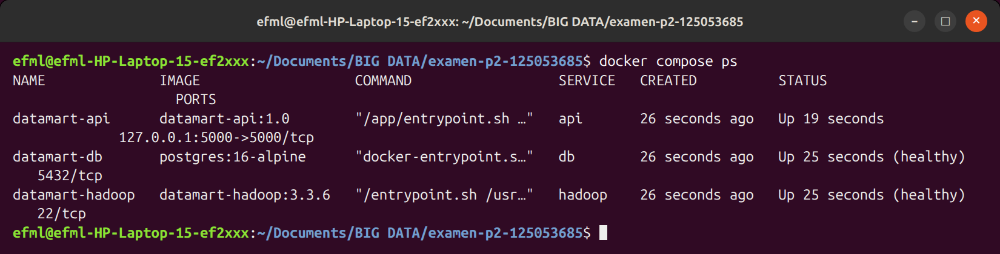

**`hadoop version`** (A1)
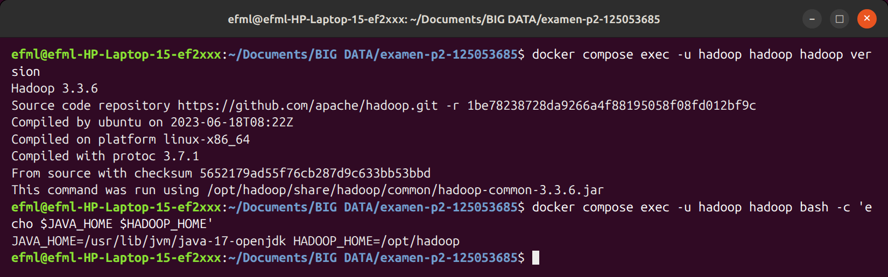

**SSH sin contraseña**: `ssh localhost` y `api → hadoop` (B)
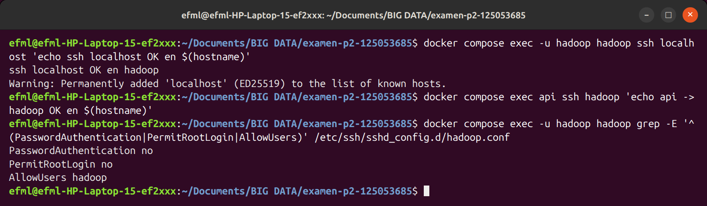

**Job Hadoop Streaming** (C1) y su **salida `part-00000`**
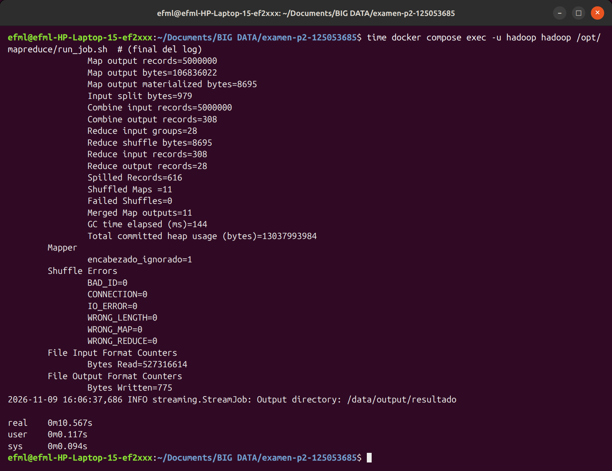
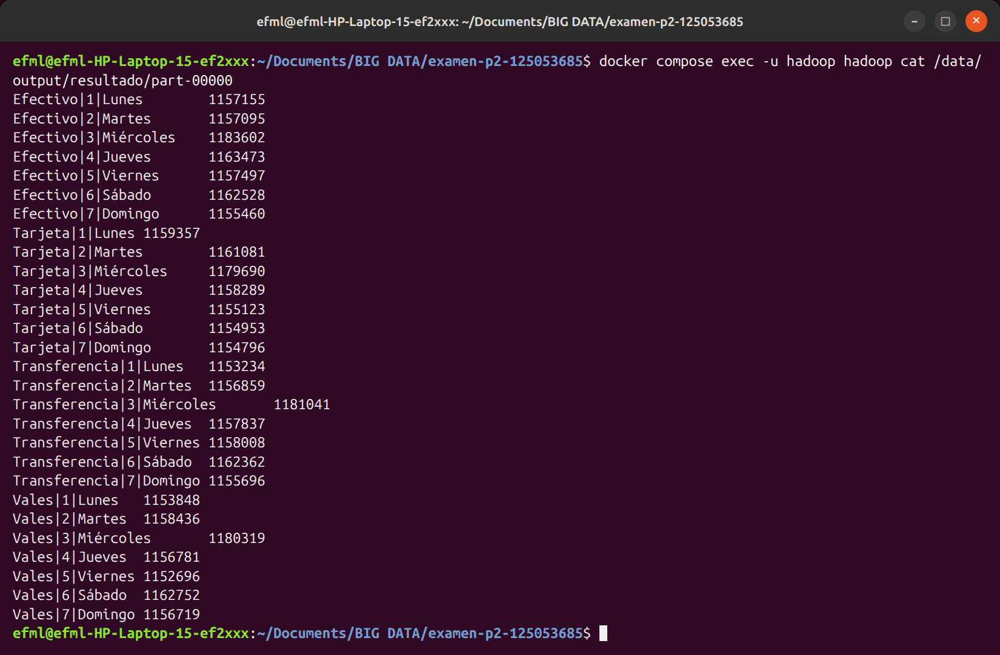

**Comparativa de tiempos y verificación de igualdad** (C2)
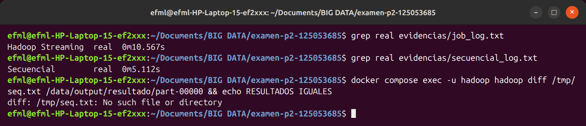

**Mapper ante líneas malformadas** (C1)
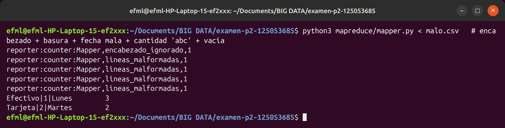

**API: GET y filtro por clave** (D)
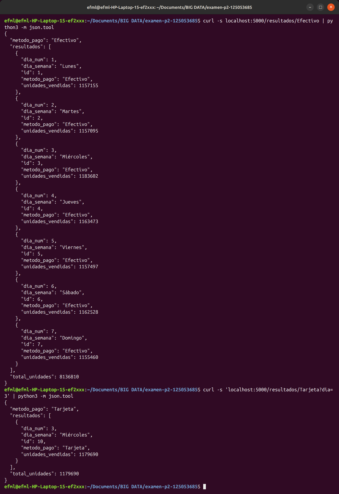

**API: POST / PUT / DELETE** (D)
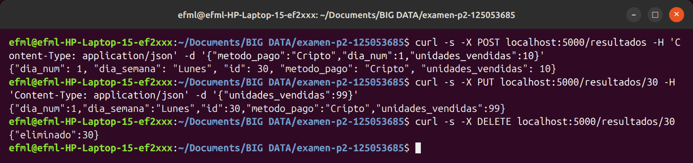

**Persistencia tras `down` / `up`** (D)
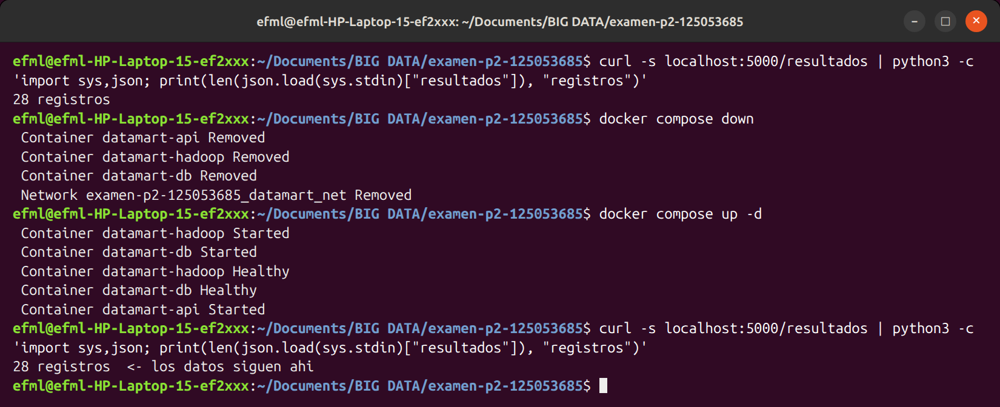

**Efecto de `down -v`**
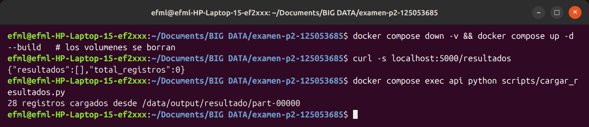

Tiempos medidos con `time` (columna *real*), ambos **dentro del contenedor `hadoop`**, sobre el mismo CSV (5 000 001 líneas, 352 MB):

| Método | Tiempo (`real`) | Resultado |
|---|---|---|
| Hadoop Streaming (local, standalone, 4 mappers en paralelo, combiner) | **10.6 s** | 28 llaves, 32 506 687 unidades |
| Script secuencial (línea a línea) | **5.1 s** | idéntico (`diff` sin diferencias) |
| Referencia en host (Python 3.14, sin Docker) | 4.7 s | idéntico |

Counters relevantes del job: `Map input records=5000001`, `Combine output records=308`, `Reduce input records=308`, `Reduce output records=28`, `encabezado_ignorado=1`. El combiner reduce 5 M de registros a 308 antes del *shuffle*.

**Explicación:** el script secuencial (5.1 s) resultó ~2× más rápido que Hadoop (10.6 s). En modo standalone, Hadoop corre el job en una sola JVM con el *LocalJobRunner*, sin HDFS ni varios nodos. Para 350–400 MB el costo fijo de Hadoop (arrancar la JVM, empaquetar y localizar el job, lanzar un proceso Python por cada split, serializar por *pipes* stdin/stdout, ordenar/«shufflear» y escribir archivos intermedios) supera con mucho el trabajo útil, mientras que el script secuencial lee el archivo una vez, de forma lineal, y acumula en un diccionario de solo 28 llaves en memoria. Por eso el secuencial es más rápido en este escenario; MapReduce solo compensa cuando los datos exceden la memoria/disco de una máquina y se reparten entre muchos nodos con HDFS.

## 6. Teoría (Parte E)

**1. Modos de Hadoop.** *Standalone*: un solo proceso Java en una máquina, sin demonios y usando el sistema de archivos local; sirve para depurar. *Pseudo-distribuido*: todos los demonios (NameNode, DataNode, ResourceManager, NodeManager) corren en una sola máquina como procesos separados, simulando un clúster; requiere SSH sin contraseña a localhost. *Totalmente distribuido*: los demonios se reparten en varios nodos reales. **HDFS se usa en el pseudo-distribuido y en el distribuido**; en standalone no hay HDFS.

**2. ¿Por qué volumen y no `COPY`?** (a) El dataset (~400 MB) inflaría la imagen y cada `build`/`push` lo arrastraría; los datos no son parte del software. (b) La imagen quedaría atada a un dataset concreto y habría que reconstruirla para cambiarlo, mientras que con un volumen se reemplaza el archivo sin rebuild. (c) Con `:ro` se garantiza que el contenedor no modifique el original, y evita subirlo por error al repositorio o a un registry (datos personales/pesados).

**3. `docker compose down` vs `down -v`.** `down` detiene y elimina contenedores y redes, pero **conserva los volúmenes nombrados**, así que los datos de PostgreSQL siguen al volver a hacer `up`. `down -v` además **elimina los volúmenes** (`pgdata`, `mr_output`, `ssh_keys`), por lo que la base de datos se pierde y hay que recargar los resultados.

**4. MapReduce vs. script secuencial en 400 MB.** Un archivo de 400 MB cabe en una máquina y se procesa en segundos de forma secuencial; Hadoop agrega sobrecarga fija (JVM, planificación, shuffle/sort, E/S a disco, procesos Python por *streaming*) que no se amortiza. Conviene MapReduce cuando los datos son del orden de cientos de GB–TB, no caben en la memoria/disco de un equipo, existe un clúster con HDFS (localidad de datos), la lógica es paralelizable por llave y se necesita tolerancia a fallos y escalado horizontal.

**5. `CMD` vs `ENTRYPOINT`; `COPY` vs `ADD`.** `ENTRYPOINT` define el ejecutable fijo del contenedor (solo se cambia con `--entrypoint`) y `CMD` los argumentos/comando por defecto, que se sobrescriben fácilmente en `docker run`; combinados, `CMD` da los argumentos de `ENTRYPOINT` (aquí: `entrypoint.sh` + `sshd -D`). `COPY` solo copia archivos/carpetas del contexto a la imagen; `ADD` hace lo mismo pero además descomprime tar locales y acepta URLs, por lo que se recomienda `COPY` salvo que se necesite eso.

## 7. Parte F — guía rápida para la defensa oral

* **Cambiar el puerto de la API:** `.env` → `API_PORT=8080`, `docker compose up -d` (solo cambia el mapeo host:contenedor del `ports` de `api`).
* **Otra agregación** (promedio / filtro por mes): editar `mapreduce/mapper.py` (por ejemplo filtrar con `campos[1][5:7] == "03"`, o emitir `cantidad,1` y calcular promedio en el reducer — sin combiner en ese caso) y volver a correr `./run_job.sh` (la carpeta `mapreduce/` está montada, no hace falta reconstruir).
* **Borrar el volumen de BD:** `docker compose down -v && docker compose up -d` y `docker compose exec api python scripts/cargar_resultados.py` (requiere re-ejecutar el job porque `mr_output` también se borra, o usar `docker volume rm <proyecto>_pgdata` para borrar solo la BD).
* **Diagnóstico:** `docker compose logs <servicio>`, `docker compose ps`, `docker compose exec`.

## 8. Seguridad / penalizaciones evitadas

* La API publica su puerto solo en `127.0.0.1` del host. No implementa autenticación en POST/PUT/DELETE porque el examen no lo pide (es un ambiente de laboratorio); en producción se añadiría una API key o token. La llave SSH se monta en `api` en solo lectura porque la Parte B exige `ssh hadoop@hadoop` desde ese contenedor.
* El CSV **no** está en el repo (`*.csv`, `data/*` en `.gitignore`).
* No hay credenciales en el repo: `.env` está ignorado y `.env.example` solo trae un marcador. No hay contraseñas en ningún Dockerfile.
* Reproducible con `docker compose up --build` (tras `cp .env.example .env`).
